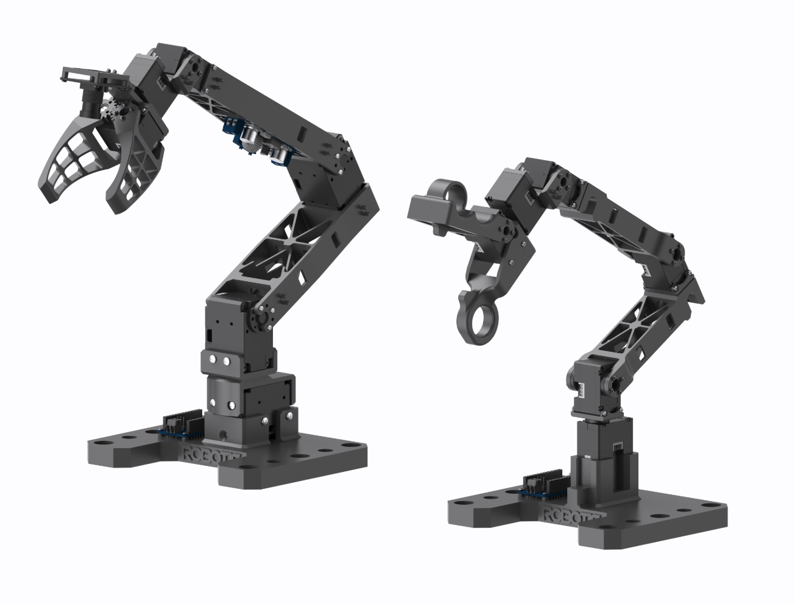

<div align="center">

# omx-doctor
### ROBOTIS OMX의 DYNAMIXEL 모터를 진단하고 고치는 도구

[English](README.md) · **한국어**

**김연우 · 김유민**  
감수: 유신 박사

[](https://docs.robotis.com/docs/systems/omx/introduction/)
[](https://github.com/huggingface/lerobot)
[](https://huggingface.co/lerobot-omx)  
[](https://huggingface.co/lerobot-omx/omx-act-models)
[](https://huggingface.co/lerobot-omx/omx-setup)
[](LICENSE)



<sub>왼쪽이 OMX-F 팔로워, 오른쪽이 OMX-L 리더입니다. 이미지: ROBOTIS</sub>

</div>

> 🤝 **함께 만들어 갈 분을 언제나 환영합니다!** 이 도구는 로봇 팔 한 대에서
> 출발했습니다. 그래서 여러분의 OMX에서는 저희가 겪어 보지 못한 일이 분명
> 생길 거예요. 그런 이야기를 꼭 듣고 싶습니다. 버그나 헷갈리는 메시지를
> 발견하셨거나, 내 로봇을 잘못 판정하는 결과를 보셨다면
> [이슈](https://github.com/yanwoo8/omx-doctor/issues)를 남기거나 풀 리퀘스트를
> 보내 주세요. 아무리 작은 기여라도 반갑고, 이 도구를 같이 키워 가고 싶은
> 분이라면 더욱 환영합니다. 🙌 시작하는 방법은 [개발](#개발) 항목에 있습니다.

omx-doctor는
[ROBOTIS OMX](https://docs.robotis.com/docs/systems/omx/introduction/)(OMX-F
팔로워 팔과 OMX-L 리더)가 제대로 동작하지 않을 때 쓰는 명령줄 도구입니다.
그리퍼가 잡을 때마다 `Overload`에 걸리거나, 맞춰 둔 가동 범위가 저절로
초기화되거나, 팔로워가 리더를 제대로 따라오지 않을 때 원인을 찾아 줍니다.

OMX는 예전 제품인 OpenMANIPULATOR-X와 다른 제품입니다. 이 도구는 OMX를
기준으로 만들고 테스트했습니다.

### 이 도구가 나온 배경

omx-doctor는 Hugging Face organization
[**lerobot-omx**](https://huggingface.co/lerobot-omx)에서 진행한 모방학습
작업에서 나왔습니다. 이곳에서 OMX로 텔레오퍼레이션 시연을 녹화하고, 정책을
학습시키고, 실제 로봇 팔에서 rollout까지 해 봤습니다.

- [**omx-act-models**](https://huggingface.co/lerobot-omx/omx-act-models):
  학습한 ACT 정책과 모델별 rollout 결과
- [**omx-setup**](https://huggingface.co/lerobot-omx/omx-setup): 그 과정에서
  남긴 트러블슈팅 기록. 이 도구의 점검 항목은 모두 이 기록 속 한 단계에서
  출발했습니다.

OMX 하드웨어와 문서를 만들어 준 [ROBOTIS](https://www.robotis.com/), 그리고 이
모든 작업의 기반이 된 프레임워크를 만든 Hugging Face의
[LeRobot](https://github.com/huggingface/lerobot) 팀에 감사드립니다.

쓰는 방법은 간단합니다. 설치한 다음, 아래 표에서 내 증상을 찾고, 해당 항목을
처음부터 따라가면 됩니다. "(LeRobot)"이 붙은 항목은
[LeRobot](https://github.com/huggingface/lerobot)을 쓰는 경우에만 해당하고,
나머지는 USB로 연결하는 DYNAMIXEL Protocol 2.0 로봇 팔이라면 어디서나 쓸 수
있습니다.

**이 문서에 나오는 숫자는 모두 예시입니다.** 가동 범위, 게인, 전류 한계는
로봇 팔마다 다릅니다. 반드시 내 로봇에서 직접 측정하세요.

## 설치

omx-doctor는 Linux에서 동작하며, Windows에서는 WSL2를 쓰면 됩니다. 로봇 팔을
`/dev/ttyUSB*`와 `/dev/ttyACM*`에서 찾기 때문에 네이티브 Windows나 macOS에서는
동작하지 않습니다.

먼저 OMX나 LeRobot(또는 둘 다)에 쓰는 가상환경을 활성화하세요.

```bash
conda activate <your-env>        # conda
source <your-env>/bin/activate   # venv
```

그다음 설치합니다.

```bash
git clone https://github.com/yanwoo8/omx-doctor.git
cd omx-doctor
pip install -e .
omx-doctor status
```

`omx-doctor` 명령은 그 가상환경이 활성화되어 있을 때만 쓸 수 있습니다.
LeRobot을 쓴다면 LeRobot과 같은 가상환경에 설치하세요. 그래야 omx-doctor가
LeRobot이 내 모터 설정을 유지하도록 만들 수 있습니다
([2.5](#25-설정이-유지되지-않을-때-lerobot)).

필요한 패키지는 `dynamixel-sdk` 하나뿐입니다. `status`가 시리얼 포트를 찾지
못한다면, 내 계정을 `dialout` 그룹에 추가한 뒤 로그아웃했다가 다시
로그인하세요.

```bash
sudo usermod -aG dialout "$USER"
```

WSL2에서는 Windows 쪽에서 [usbipd-win](https://github.com/dorssel/usbipd-win)으로
USB 어댑터를 연결해 줘야 WSL에서 보입니다. 관리자 권한 PowerShell에서
`usbipd list`로 어댑터의 BUSID를 확인한 뒤 실행하세요.

```powershell
usbipd bind --busid <BUSID>            # 처음 한 번만
usbipd attach --wsl --busid <BUSID>    # USB를 다시 꽂거나 재부팅할 때마다
```

## 시작하기 전에

**LeRobot부터 끄세요.** RS-485 통신에서는 마스터가 하나만 있어야 합니다. 두
프로그램이 한 포트를 같이 쓰면 양쪽 통신이 모두 깨집니다.

**전원을 껐다 켜도 남는 설정과 사라지는 설정을 구분하세요.** 헷갈리는 증상
대부분이 여기서 나옵니다.

| 영역 | 레지스터 | 전원을 꺼도 유지 | 쓸 수 있는 조건 |
| --- | --- | --- | --- |
| EEPROM | 가동 범위, 전류 한계, 동작 모드, 홈 오프셋 | 유지됨 | 토크가 꺼져 있고 에러가 없을 때 |
| RAM | 목표 전류, 위치 게인, 목표 위치 | 사라짐 | 언제든지 |

모터는 범위를 벗어난 값을 받으면 아무 말 없이 무시하고 이전 값을 유지합니다.
그래서 이 도구는 값을 쓸 때마다 다시 읽어서 확인하고, 결과를 `ok` 또는
`REFUSED`로 알려 줍니다.

## 증상별 바로가기

| 증상 | 바로가기 |
| --- | --- |
| 아직 뭐가 문제인지 모르겠다 | [1. 진단](#1-진단) |
| 빨간 LED가 켜졌거나, 모터가 명령을 거부한다 | [1.3 에러 해제와 토크 풀기](#13-에러-해제와-토크-풀기) |
| 그리퍼가 잡을 때마다 `Overload`(에러 32)가 뜬다 | [2. 그리퍼의 Overload](#2-그리퍼의-overload) |
| 모터가 뜨거워지고 힘을 못 쓴다 | [2. 그리퍼의 Overload](#2-그리퍼의-overload) |
| 관절이 원래 닿아야 할 곳까지 가지 못한다 | [3. 가동 범위](#3-가동-범위) |
| 다음에 실행하면 설정이 원래대로 돌아간다 | [2.5 설정이 유지되지 않을 때](#25-설정이-유지되지-않을-때-lerobot) |
| LeRobot이 매번 캘리브레이션을 다시 하라고 한다 | [3.3 캘리브레이션 파일도 함께 저장하기](#33-캘리브레이션-파일도-함께-저장하기-lerobot) |
| 팔로워가 리더와 다른 각도로 서 있다 | [4. 리더와 팔로워](#4-리더와-팔로워) |
| 팔로워 그리퍼가 끝까지 열리지 않는다 | [4.4 그리퍼가 끝까지 열리지 않을 때](#44-그리퍼가-끝까지-열리지-않을-때) |
| 해당하는 게 없고, 명령어 목록을 보고 싶다 | [명령어 요약](#명령어-요약) |

---

## 1. 진단

### 1.1 모든 모터 읽기

```bash
omx-doctor status
```

```
/dev/ttyACM0
  ID   MODEL   MODE                                POSITION   CURRENT     PWM   TEMP  ERROR
  11   1060    4 (extended position control)           2047         3       6     31  clear
  16   1200    5 (current-based position control)      2338      -162    -885     38  32 (Overload)

Found 2 motor(s).

id 16: Overload: go to section 2.
```

모터가 하나도 응답하지 않는다면 전원, USB 케이블, 다른 프로그램이 포트를 쓰고
있는지를 차례로 확인하세요. 모터가 하나라도 응답해야 아래 단계를 진행할 수
있습니다.

### 1.2 어디로 갈지 정하기

`ERROR`는 비트 필드라서 숫자 하나에 여러 의미가 겹쳐 있을 수 있습니다.
`status`가 이 값을 풀어서 어느 항목으로 가면 되는지 알려 줍니다.

| 에러 | 의미 | 바로가기 |
| --- | --- | --- |
| 32 `Overload` | 최대 출력을 계속 냈는데도 목표 위치에 닿지 못함 | [2](#2-그리퍼의-overload) |
| 4 `Overheating` | 온도 한계에 도달함. 전원을 끄고 식히세요 | [2](#2-그리퍼의-overload) |
| 8 `EncoderError` | 위치 센서 값을 제대로 읽지 못함 | [4.3](#43-관절-재조립) |
| 1 `InputVoltage` | 공급 전압이 허용 범위를 벗어남 | 어댑터와 배선 확인 |
| 16 `ElectricalShock` | 합선이나 권선 문제. 전원을 끄세요 | 배선 확인 |
| 0 | 에러는 없지만 움직임이 이상함 | [4](#4-리더와-팔로워) |

`Overload`는 전류가 `Current_Limit`를 넘었다는 뜻이 아닙니다. 모터가 최대
출력(PWM이 `PWM_Limit`에 붙은 상태)을 너무 오래 냈는데도 위치가 따라오지 못할
때 걸립니다. 이때 전류는 한계보다 한참 낮은 경우가 많습니다. 그래서 2번
항목에서는 전류가 아니라 PWM을 봅니다.

### 1.3 에러 해제와 토크 풀기

에러는 재부팅하거나 전원을 껐다 켜기 전까지 계속 남아 있고, 그동안 모터는
EEPROM 쓰기를 거부합니다.

```bash
omx-doctor reset
```

에러가 있는 모터만 재부팅한 다음, 모든 모터의 토크를 풀어서 손으로 팔을
움직일 수 있게 합니다. 재부팅하면 RAM도 초기화되므로, 2번 항목에서 바꾼 설정이
있다면 다시 적용하세요.

`reset`이 해제할 에러를 찾지 못했는데도 팔이 반응하지 않는다면 전원이나 배선
문제입니다.

---

## 2. 그리퍼의 Overload

2.1부터 2.3까지 차례로 진행하고, 2.6을 통과하면 멈추세요. 단단한 물체를 밀게
되는 그리퍼에서 주로 생기지만, 다른 관절에도 똑같이 적용됩니다.

### 2.1 PWM이 한계에 붙는지 확인

```bash
omx-doctor watch 16 --seconds 20
```

값을 읽기만 합니다. 평소 문제가 생기던 방식대로 로봇 팔을 움직이세요.

```
  T(S)      GOAL  POSITION   CURRENT     PWM   TEMP
 12.19      2336      2340        -8      -6     31
 12.79      2295      2338      -105    -363     31
 13.36      1999      2338      -162    -885     32
 13.76      1999      2338      -162    -885     32

PWM saturated (peak 885, limit 885). Start at section 2.2.
Temperature held steady (31 C to 32 C, peak 32 C).
Error status: 32 (Overload)
```

`POSITION`은 멈춰 있는데 `GOAL`만 멀어진다면, 모터가 갈 수 없는 곳으로 가라는
명령을 받고 있다는 뜻입니다. `PWM`이 1~2초 넘게 한계에 붙어 있으면 `Overload`가
걸립니다. 도구에서 직접 모터를 움직여 보려면 `--goal 2400`을 붙이세요.

- **PWM saturated(한계에 붙음)** → 2.2로 가세요.
- **PWM not saturated(한계에 붙지 않음)** 인데도 에러가 다시 난다 → 기구 문제일
  수 있으니 2.4로 가세요.

### 2.2 위치 게인 조정

`Position_P_Gain`은 위치 오차 1당 모터가 얼마나 큰 출력을 낼지 정합니다. 값이
크면 최대 출력에 더 빨리 도달해서 `Overload`도 빨리 걸리고, 작으면 부드럽지만
위치를 느슨하게 잡습니다. 정답인 값은 없으니 직접 측정해서 정하세요.

```bash
omx-doctor gains 16 --p 800
omx-doctor watch 16 --seconds 20
```

값을 하나만 바꾸고 `watch`를 다시 돌려 비교하세요. 관절이 물체를 못 잡을
만큼 헐거워지지 않는 선에서, 최대 PWM을 낮추는 값을 고르면 됩니다. `--i`와
`--d`도 같은 방식이며, 둘 다 0에서 시작하면 무난합니다.

게인은 RAM에 저장되므로 재부팅하면 기본값으로 돌아갑니다. 마음껏 실험해도
되지만, 그대로 유지되지는 않습니다(2.5 참고).

### 2.3 Goal_Current 낮추기

그리퍼의 `Overload`를 실제로 막는 방법은 이것입니다. `Goal_Current`는 모터가
낼 수 있는 힘의 상한이라서, PWM이 한계에 붙기 전에 모터가 먼저 힘을 멈춥니다.

```bash
omx-doctor current 16 100
```

값은 2.1에서 측정한 전류를 보고 정하세요. PWM이 한계에 붙은 순간의 전류가
모터가 도달하려던 최대치이므로, `Goal_Current`는 그보다 조금 낮게 잡아야
합니다. `Overload`가 더는 걸리지 않을 때까지 조금씩 낮추고, 그래도 물체를 잘
잡는지 확인하세요. 너무 낮으면 물체를 붙잡지 못합니다.

명령이 대신 확인해 주는 조건이 두 가지 있습니다.

- `Goal_Current`는 전류 기반 위치 제어(`Operating_Mode` 5)에서만 힘을
  제한합니다. 현재 모드는 `status`에서 볼 수 있습니다.
- `Goal_Current`는 `-Current_Limit`에서 `Current_Limit` 사이여야 합니다. 이
  범위를 벗어난 값은 성공한 것처럼 보이게 두지 않고, 쓰기 전에 거부합니다.

### 2.4 한 지점에서만 멈출 때

가동 범위 대부분에서는 잘 움직이는데 한 곳에서만 멈춘다면, 어딘가 걸리는 것입니다.
레지스터로는 고칠 수 없습니다.

```bash
omx-doctor reset
```

손으로 관절을 움직이면서 뻑뻑한 구간이 있는지 느껴 보세요. 그다음 토크를 켜고
그 구간을 지날 때의 전류를 확인하세요(2.1). 걸리는 데가 없는 관절은 내내 작은
전류를 쓰지만, 걸리는 관절은 매번 같은 자리에서 전류가 튑니다.

확인 순서는 이렇습니다. 나사가 고르지 않게 조여져 가동 범위 한쪽 끝에서
하우징이 끼이는지, 끝까지 폈을 때 케이블이 당기는지, 기어에 이물질이 있는지.
나사를 고르게 다시 조이는 게 가장 쉬운 해결책인데, 그러면 실제 가동 범위가
달라지므로 범위를 다시 측정하세요(3번 항목).

### 2.5 설정이 유지되지 않을 때 (LeRobot)

2.2와 2.3은 RAM에 쓰는 설정이라, LeRobot이 연결할 때마다 자체 설정 단계에서
덮어씁니다. LeRobot이 쓰는 설정에 내 값을 넣어 두면 됩니다.

```bash
omx-doctor patch-lerobot gripper \
  --mode 5 --current-limit 600 \
  --p 800 --i 0 --d 0 \
  --goal-current 100
```

설치된 LeRobot 소스를 직접 수정해서, LeRobot이 원래 실행하던 설정 함수에 내
값을 쓰는 코드를 끼워 넣습니다. 끼워 넣을 위치는 특정 코드 문장이 아니라
들여쓰기 구조로 찾기 때문에, LeRobot 버전이 바뀌어도 대체로 동작합니다. 소스를
찾지 못하면 `--file`로 경로를 직접 알려 주세요.

끼워 넣은 줄에는 모두 `# omx-doctor` 표시가 붙습니다.

```bash
python -c "import lerobot.robots.omx_follower.omx_follower"   # 정상적으로 불러와지는지 확인
omx-doctor patch-lerobot gripper --revert                     # 되돌리기
```

원하는 설정만 넘기면 됩니다. EEPROM 레지스터는 토크가 꺼진 구간에, `Goal_Current`는
그 뒤에 들어갑니다. 각 영역이 요구하는 조건이 그렇기 때문입니다.

### 2.6 해결됐는지 확인

```bash
omx-doctor watch 16 --seconds 60
```

예전에 실패하던 작업을, 실패하기까지 걸리던 시간보다 길게 돌려 보세요. 아래
세 가지가 모두 나오면 해결된 것입니다.

- `PWM not saturated`
- `Temperature held steady`(온도가 오르지 않음). 에러가 나지 않더라도 온도가
  계속 오른다면 아직 무리하고 있는 것입니다.
- `Error status: clear`

PWM이 여전히 한계에 붙는다 → `Goal_Current`를 더 낮추세요. 에러는 안 나는데
물체를 못 잡는다 → 조금 올리세요.

---

## 3. 가동 범위

관절이 물리적으로 닿을 수 있는 곳까지 가지 못할 때, 무언가를 재조립하거나 다시
조인 뒤, 또는 LeRobot이 범위를 0~4095 전체로 덮어썼을 때 진행하세요.

### 3.1 손으로 측정하기

```bash
omx-doctor measure 16 --seconds 30
```

먼저 토크가 풀립니다. 기록하는 동안 관절을 천천히 움직여 양쪽 기구적 끝에
닿게 하세요(이 정도면 됐다 싶은 곳이 아니라 실제로 멈추는 곳까지).
`Ctrl-C`를 누르면 일찍 끝낼 수 있습니다.

```
id 16 on /dev/ttyACM0. Torque is off.
  position   2873   min   2123   max   2873

Range 2123 to 2873 (span 750, about 66 degrees).

To write this range to the motor:
  omx-doctor set-range 16 2123 2873
```

저장할 만한 범위일 때만 이 명령을 안내합니다. 관절을 거의 움직이지 않았다면
(폭이 50 미만이면 센서 노이즈입니다) `measure`가 그렇다고 알려 주고 종료 코드
1로 끝납니다. 측정값이 0이나 4095를 넘어갔다면 관절의 영점이 엔코더 경계에
걸려 있는 것이고, 다시 측정해서는 해결되지 않습니다.
[4.3](#43-관절-재조립)으로 가세요.

### 3.2 모터에 저장하기

**LeRobot을 쓴다면 이 단계 대신 3.3으로 가세요.** 이 명령은 모터에만 저장하는데,
바로 그 상태가 측정한 범위를 지워 버리는 원인이 됩니다.

```bash
omx-doctor set-range 16 2123 2873
```

```
  Min_Position_Limit      (52)  ->  2123     ok
  Max_Position_Limit      (48)  ->  2873     ok
Stored in EEPROM. It survives a power cycle.
```

`REFUSED`는 모터가 이전 값을 그대로 유지했다는 뜻이고, 보통 범위를 벗어난
숫자였거나 토크가 켜져 있었던 경우입니다. 원인을 고친 뒤 다시 실행하세요.
폭이 50 미만인 범위는 관절을 사실상 움직이지 못하게 만들기 때문에, 아무것도
쓰기 전에 거부합니다.

`--homing-offset` 옵션도 있지만, 이 값은 위치 한계를 표현하는 기준 자체를 옮기기
때문에 방금 측정한 범위가 쓸모없어집니다. 꼭 필요하다는 확신이 없다면 건드리지
마세요.

### 3.3 캘리브레이션 파일도 함께 저장하기 (LeRobot)

LeRobot은 가동 범위를 따로 저장해 두고, 연결할 때마다 EEPROM 값과 비교합니다.
둘이 다르면 캘리브레이션을 다시 하라고 하고, 그 과정에서 범위를 0~4095로
덮어씁니다. 그래서 EEPROM에만 저장하면 범위는 반드시 지워집니다.

```bash
omx-doctor sync-calib 16 gripper 2123 2873
```

인자는 모터 ID, LeRobot에서 부르는 관절 이름, 범위 순서입니다. 캘리브레이션
파일은 관절 이름과 모터 ID가 모두 일치하는 것으로 찾기 때문에, 관절 이름이 같은
리더와 팔로워 프로필을 헷갈리지 않습니다.

```
Calibration file: ~/.cache/huggingface/lerobot/calibration/robots/omx_follower/omx_follower_arm.json
  now:  id 16, homing_offset 0, range 0 to 4095

id 16 on /dev/ttyACM0
  Min_Position_Limit      (52)  ->  2123     ok
  Max_Position_Limit      (48)  ->  2873     ok

Calibration file updated. The original is at ...json.bak
  now:  id 16, homing_offset 0, range 2123 to 2873

EEPROM and the file agree, so LeRobot will not ask to recalibrate.
```

EEPROM에 먼저 쓰는 데에는 이유가 있습니다. 쓰기가 거부되면 파일은 건드리지
않는데, 둘 중 하나만 바뀌어 서로 어긋나는 것이 둘 다 그대로인 것보다 나쁘기
때문입니다. 원래 파일은 `.bak`으로 보관됩니다.

조건에 맞는 캘리브레이션 파일이 여러 개라면, 짐작해서 고르지 않고 멈춥니다.
쓰지 않는 프로필을 다른 곳으로 옮기고 다시 실행하세요.

### 3.4 확인

```bash
omx-doctor status
```

그다음 LeRobot으로 한 번 연결해 보세요. 캘리브레이션을 다시 하라고 하지 않으면
성공입니다. 여전히 그렇다면 두 값이 아직 다른 것이니, `sync-calib`를 다시
실행하고 `ok` 줄을 확인하세요.

---

## 4. 리더와 팔로워

팔로워가 눈에 띄게 리더와 다른 자세를 취하거나, 나머지는 잘 따라오는데 관절
하나만 계속 어긋날 때 진행하세요.

### 4.1 위치 비교

먼저 두 팔을 같은 자세로 맞추세요. 움직이는 중인 팔과 비교한 오프셋은 의미가
없습니다.

```bash
omx-doctor compare 1:11 2:12 3:13 4:14 5:15 6:16
```

인자는 `리더:팔로워` 형식입니다. 내 로봇의 ID를 쓰세요. ID는 `status`에서
확인할 수 있습니다.

```
  PAIR               LEADER  FOLLOWER    OFFSET
  1:11                 2047      2051         4
  6:16                 2048      2280       232

1:11  Offset 4. Within the normal range.
6:16  Offset 232. The zero point has drifted. Measure the range and zero again in section 3.
```

### 4.2 오프셋 읽는 법

| 오프셋 | 의미 | 할 일 |
| --- | --- | --- |
| 약 150 이하 | 정상적인 유격과 센서 노이즈 | 없음 |
| 약 150~400 | 영점이 틀어짐 | [3](#3-가동-범위) |
| 400 이상 | 관절이 다른 각도로 조립됨 | [4.3](#43-관절-재조립) |

4096이 한 바퀴이므로, 약 11.4로 나누면 각도가 됩니다. 작은 오프셋은 굳이
쫓아가지 않아도 됩니다. 텔레오퍼레이션이 알아서 흡수합니다.

`compare`는 두 값 중 하나라도 0이나 4095에서 약 200 이내에 있거나 그 범위를
넘어가면 경고합니다. 이런 관절은 4090으로 읽히다가 바로 다음 순간 -6으로 읽힐 수
있고, 모터는 이를 한 바퀴 회전으로 받아들입니다. 그래서 두 팔이 겉보기에 맞아
보여도 `Overload`가 걸립니다. 기본 자세에서 2048 근처가 나오도록 재조립하세요
([4.3](#43-관절-재조립)).

### 4.3 관절 재조립

오프셋이 크다면, 한쪽 팔의 출력 혼(horn)이 다른 각도로 체결된 것입니다.
모터의 영점과 링크의 영점이 실제로 다른 곳에 있기 때문에, 어떤 레지스터로도
고칠 수 없습니다.

토크를 풀고, 볼트를 풀고, 혼을 반대편 팔에 맞게 돌린 뒤 다시 조이세요. 혼은
정해진 각도 단위로만 끼울 수 있으니, 영점에 딱 맞추기보다 한 칸 이내로 맞추면
됩니다. 기구적 끝 위치가 달라졌으므로 가동 범위를 다시 측정하세요(3번 항목).

두 팔이 모두 어긋나 있다면 서로 맞추는 것만으로는 부족합니다. 두 팔 모두 기본
자세에서 2048 근처, 즉 0과 4095에서 충분히 떨어진 값이 나오도록 맞춰야
관절이 엔코더 경계를 넘지 않습니다(4.2).

### 4.4 그리퍼가 끝까지 열리지 않을 때

원인은 두 가지이고, 아래 순서대로 확인하세요.

**가동 범위.** `Max_Position_Limit`가 그리퍼가 실제로 열리는 위치보다 낮으면,
모터는 명령받은 대로 한계에서 멈춥니다. 범위를 측정해서 저장하세요(3번 항목).

**LeRobot 자체의 제한.** `gripper_open_pos`는 팔로워에 보내는 목표값의 상한입니다.
텔레오퍼레이션과 녹화에 따로 적용되기 때문에, 한쪽에만 넘기면 정확히 이 증상이
나타납니다.

```bash
lerobot-teleoperate  ... --teleop.gripper_open_pos=95
lerobot-record       ... --teleop.gripper_open_pos=95
```

---

## 5. 자주 걸리는 함정

**한 포트를 두 프로그램이 같이 쓰는 경우.** LeRobot, 이 도구, 깜빡 켜 둔
Python 셸이 무엇이든 섞이면 모두의 통신이 깨지고, 겉으로는 무작위 통신 오류처럼
보입니다. 다른 프로그램을 먼저 모두 끄세요.

**장치 이름은 바뀝니다.** `/dev/ttyACM0`과 `ttyACM1`은 꽂는 순서에 따라 서로
바뀌기 때문에, 스크립트에 포트 이름을 적어 두면 언젠가는 엉뚱한 팔을 가리키게
됩니다. 이 도구의 명령은 모두 포트 이름 대신 모든 포트에서 ID로 모터를
찾습니다.

**재부팅하면 RAM이 초기화됩니다.** `reset`을 비롯해 모터를 재부팅하는 작업을
한 뒤에는, 2번 항목에서 정한 게인과 목표 전류를 다시 적용하세요.

**범위를 벗어난 값을 써도 성공한 것처럼 보입니다.** 쓴 값은 반드시 다시 읽어서
확인하세요.

**텔레메트리가 추론보다 더 무거울 수 있습니다.** LeRobot 루프가 느리다면, 모델보다
실시간 시각화를 먼저 의심하세요. `--display_data=false`로 끌 수 있습니다.

---

## 명령어 요약

| 명령 | 하는 일 | 항목 |
| --- | --- | --- |
| `status` | 모든 모터를 찾아 위치, 전류, PWM, 온도, 에러를 출력 | [1.1](#11-모든-모터-읽기) |
| `reset` | 에러가 있는 모터를 재부팅하고, 모든 모터의 토크를 해제 | [1.3](#13-에러-해제와-토크-풀기) |
| `watch ID` | PWM과 전류를 기록하고, PWM이 한계에 붙었는지 판정 | [2.1](#21-pwm이-한계에-붙는지-확인) |
| `gains ID --p --i --d` | 위치 게인을 쓰고 확인 | [2.2](#22-위치-게인-조정) |
| `current ID VALUE` | `Goal_Current`를 쓰고 확인 | [2.3](#23-goal_current-낮추기) |
| `patch-lerobot JOINT` | LeRobot이 연결할 때마다 내 설정을 다시 적용하게 만듦 | [2.5](#25-설정이-유지되지-않을-때-lerobot) |
| `measure ID` | 토크를 풀고 가동 범위를 기록 | [3.1](#31-손으로-측정하기) |
| `set-range ID MIN MAX` | 가동 범위를 EEPROM에 쓰고 확인 | [3.2](#32-모터에-저장하기) |
| `sync-calib ID JOINT MIN MAX` | 가동 범위를 EEPROM과 캘리브레이션 파일에 함께 저장 | [3.3](#33-캘리브레이션-파일도-함께-저장하기-lerobot) |
| `compare L:F ...` | 리더와 팔로워의 위치를 비교 | [4.1](#41-위치-비교) |

모든 명령은 `--help`를 지원합니다. `status`와 `reset`은 `--ids`, `watch`와
`measure`는 `--seconds` 옵션을 받습니다. 확인할 것이 없으면 종료 코드 0, 있으면
1로 끝나므로 스크립트에 넣어 쓰기 좋습니다.

## 도구 없이 직접 하기

이 도구의 명령은 모두 아래 세 가지 방식으로 이루어져 있습니다. 도구를 설치할
수 없는 상황에서 알아 두면 유용합니다.

포트 이름은 바뀌므로, 포트 이름이 아니라 ID로 모터를 찾습니다.

```python
from dynamixel_sdk import PacketHandler, PortHandler, COMM_SUCCESS
import glob

ph = PacketHandler(2.0)
for device in sorted(glob.glob("/dev/ttyUSB*") + glob.glob("/dev/ttyACM*")):
    port = PortHandler(device)
    if port.openPort() and port.setBaudRate(1_000_000):
        if ph.ping(port, MOTOR_ID)[1] == COMM_SUCCESS:
            break
        port.closePort()
```

범위를 벗어난 값은 조용히 무시되므로, 쓴 값은 모두 다시 읽어서 확인합니다.

```python
ph.write2ByteTxRx(port, MOTOR_ID, address, value)
readback, _, _ = ph.read2ByteTxRx(port, MOTOR_ID, address)
assert readback == value
```

EEPROM에 쓰기 전에는 에러를 해제하고 토크를 풀어야 합니다. 그렇지 않으면
거부됩니다.

```python
import time

if ph.read1ByteTxRx(port, MOTOR_ID, 70)[0]:   # Hardware_Error_Status
    ph.reboot(port, MOTOR_ID)
    time.sleep(1.5)
ph.write1ByteTxRx(port, MOTOR_ID, 64, 0)      # Torque_Enable = 0
```

에러가 걸려 있는 동안에는 모터의 모든 응답에서 error 필드에 0x80이 켜집니다
(SDK는 "Hardware error occurred"라고 출력합니다). 그래도 그 응답에 담긴 값은
정상이므로, 이 비트만 보고 읽은 값을 버리지 마세요.

레지스터 주소는 `src/omx_doctor/registers.py`에 있고, 모델별 컨트롤 테이블은
[DYNAMIXEL X 시리즈 모델 레퍼런스](https://docs.robotis.com/docs/dxl/model_reference/x_series/)에서
볼 수 있습니다.

## 개발

```bash
pip install -e ".[dev]"
pytest
```

```
src/omx_doctor/
  registers.py   컨트롤 테이블 주소와 에러 비트 (데이터만)
  decode.py      비트 해석, 부호 변환, 판정 (순수 함수)
  patch.py       LeRobot 소스에 설정을 넣을 위치 찾기 (순수 함수)
  calib.py       캘리브레이션 파일 찾기와 수정
  bus.py         포트 탐색, 확인을 거친 읽기와 쓰기 (하드웨어 입출력)
  commands.py    하위 명령 구현
  cli.py         인자 처리
tests/
  conftest.py    dynamixel_sdk를 대신하는 가상 DYNAMIXEL 버스
  test_*.py      단위 테스트, 그리고 가상 버스 위에서 모든 하위 명령 실행
```

하드웨어와 통신하는 코드는 `bus.py`에만 있기 때문에, 로봇 없이도 테스트를
돌릴 수 있습니다. `decode.py`, `patch.py`, `calib.py`는 직접 테스트하고, 하위
명령들은 `tests/conftest.py`의 가상 버스 위에서 실행합니다. 이 가상 모터는 이
도구가 의존하는 Protocol 2.0 규칙을 그대로 따릅니다. 에러가 걸려 있으면 0x80
Alert 비트를 붙이고, 토크가 켜져 있으면 EEPROM 쓰기를 거부하고, 범위를 벗어난
값을 거부하고, 재부팅하면 RAM을 초기화합니다. 테스트 중 상당수는 실제 로봇
팔에서 측정한 값을 씁니다. 이렇게 나눈 데에는 이유가 있습니다. 이 도구는
저희가 직접 테스트해 볼 수 없는 로봇 팔들을 위해 공개하는 것이라, 따로
검증할 수 있는 부분은 계속 검증할 수 있게 유지해야 하기 때문입니다.

명령이 모터와 통신하는 방식을 바꿨다면 `tests/test_commands.py`에 테스트를
추가해 주세요. 실제 하드웨어가 가상 버스와 다르게 동작한다면 `conftest.py`도
함께 고치고, 풀 리퀘스트에 직접 관찰한 내용을 적어 주세요.

다른 로봇 팔에서 써 본 결과도 환영합니다. 특히 `decode.py`의 판정 기준값이 내
하드웨어를 잘못 판정한다면 꼭 알려 주세요.

`trouble_shooting_log/`에는 이 도구가 나오기까지의 작업 기록이 있습니다. 무엇을
시도했는지, 어떤 값이 측정됐는지, 어떤 시도가 실패했는지가 담겨 있습니다. 로봇
팔 한 대의 기록일 뿐 따라 할 안내서가 아니므로, 그 안의 숫자를 설정값으로
그대로 가져다 쓰지 마세요. (이 폴더의 기록은 영어로 작성되어 있습니다.)

## 만든 사람들

이 도구의 방법들은 Physical AI 로봇 액션 모델링 과정에서 ROBOTIS OMX 한 대로
함께 찾아낸 것입니다.

- [김연우](https://github.com/yanwoo8)
- [김유민](https://github.com/Yu-billie)

감수: 유신 박사 (ys9072@paran.com), Physical AI 로봇 액션 모델링 과정 강사

## 라이선스

Apache-2.0. 자세한 내용은 [LICENSE](LICENSE)를 보세요.
